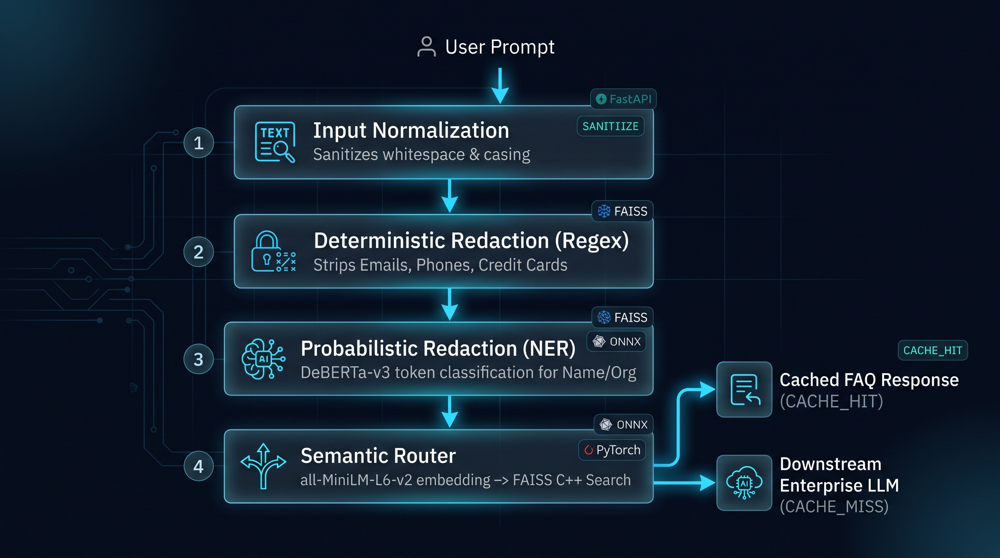

# AI Security Gateway & Semantic Router

**Task.** An asynchronous, production-ready FastAPI microservice acting as a security and routing layer for Enterprise RAG systems. It intercepts user prompts, redacts PII using a hybrid Regex/NER approach, and uses Vector Search to route queries to cached FAQs or downstream LLMs.

**Approach.** We evaluate zero-shot ONNX `DeBERTa-v3` (Token Classification) and `all-MiniLM-L6-v2` (Sentence Embeddings) against regex/keyword baselines. To resolve Italian domain-shift vulnerabilities (54% NER recall), we adapt the DeBERTa model using Supervised Fine-Tuning (LoRA PEFT) combined with an LLM-assisted knowledge distillation data pipeline.

| Step | What | Where |
| :--- | :--- | :--- |
| 1 | Data exploration & unified JSONL preprocessing (LLM synthetic gen) | `src/gateway/data/`, `notebooks/` |
| 2 | Zero-shot baseline evaluation & ONNX routing (`E0`) | `src/gateway/infer/`, `src/gateway/eval/` |
| 3 | Model adaptation / Fine-tuning (`E1+`) | `src/gateway/train/` |
| 4 | FastAPI Microservice & Lifecycle Hooks | `src/gateway/infer/main.py` |

---

## 📍 Project Roadmap & Status

This project follows an iterative MLOps lifecycle:

- [x] **Phase 1: Infrastructure & Baseline Benchmarks (Completed)**
  - Async FastAPI setup with `lifespan` model loading.
  - Regex vs. Zero-Shot DeBERTa-v3 evaluation (NER) & Keyword vs. FAISS evaluation (Routing).
  - Transitioned to strictly-typed ADSP project scaffold.
- [ ] **Phase 2: Domain Adaptation via LoRA PEFT (Active)**
  - LLM-assisted synthetic JSON data generation for high-variance Italian domain data.
  - BIO-tagging pipeline implementation.
  - LoRA Fine-tuning on DeBERTa to resolve enterprise domain shift.
- [ ] **Phase 3: Production Inference Optimization (Planned)**
  - Merging LoRA adapters and compiling the finalized model to ONNX.
  - End-to-end latency and memory benchmarking.

---

## Setup

Requires Python 3.11.

```bash
# With uv (recommended)
uv venv -p 3.11
uv pip install -e ".[dev]"            # Light: schema, config, tests (CPU only)
uv pip install -e ".[dev,infer]"      # + fastapi / onnxruntime / faiss-cpu (Production API)
uv pip install -e ".[dev,train,eval]" # + torch / transformers / peft / seqeval (MLOps pipeline)

# Install git guards and environment secrets
pre-commit install                    # ruff + "no raw data / no weights" guards on commit
cp .env.example .env                  # Fill in WANDB/MLflow keys (never commit .env)
```

## 📂 Folder Map
* `configs/` - one YAML per experiment (E0 zero-shot, E1 LoRA, …)
* `data/` - download/preprocess scripts + ID lists ONLY (no raw JSONs in git)
* `src/gateway/data/` - LLM generation scripts -> unified JSONL/BIO arrays
* `src/gateway/infer/` - FastAPI gateway, ONNX router, and redaction microservices
* `src/gateway/train/` - LoRA SFT training loops
* `src/gateway/eval/` - seqeval metrics and performance chart generation
* `src/gateway/common/` - JSONL schema, config loading, logging (shared)
* `outputs/` - trained adapters, scores CSV (gitignored)
* `docs/` - architecture diagrams and evaluation reports
* `tests/` - unit and repository hygiene tests

---

## 🚀 The API Gateway

On startup, the API initializes the brain. Through the async `lifespan` handler, it safely downloads and loads the ONNX models into RAM, compiles the target FAISS dataset, and prepares your CPU-accelerated worker pool *before* allowing the gateway to receive its first network request.

```bash
# Run using the lightweight infer dependencies
uvicorn src.gateway.infer.main:app --reload
```

### 🔌 API Usage

**Endpoint:** `POST /api/v1/gateway`

**Request:**
```json
{
  "prompts": [
    "My name is Behrad and I spilled coffee on my ThinkPad."
  ]
}
```

**Response:**
```json
{
  "results": [
    {
      "original_prompt": "My name is Behrad and I spilled coffee on my ThinkPad.",
      "redacted_prompt": "My name is [REDACTED] and I spilled coffee on my ThinkPad.",
      "routing": {
        "action": "CACHE_HIT",
        "score": 0.6389,
        "response": "What do I do if I spilled water on my laptop?"
      }
    }
  ]
}
```

---

## 🏗 Architecture

<p align="center">
  
</p>

This gateway executes a strict pipeline before any prompt touches a generative LLM:
1. **Input Normalization:** Sanitizes whitespace and structural casing.
2. **Deterministic Redaction (Regex):** Strips structured PII (Emails, Phone Numbers, Credit Cards).
3. **Probabilistic Redaction (NER):** Uses `DeBERTa-v3` token classification for unstructured PII (Names, Organizations). Implements interval-merging for subword fragmentation.
4. **Semantic Routing:** Embeds the sanitized prompt using `all-MiniLM-L6-v2` and searches a `FAISS` IndexFlatIP (Cosine Similarity) C++ struct to return cached answers in $O(N)$ time.

---

## 📊 Evaluation Results (Phase 1 Baseline)

### Semantic Router (Hit Rate @ 1)
| Engine | Strategy | Hit Rate |
| :--- | :--- | :--- |
| **Baseline** | Rigid Keyword Substrings | 0.0% |
| **FAISS AI** | Cosine Similarity (`all-MiniLM-L6-v2`) | **80.0%** |

### PII Redaction (Entity Extraction)
| Engine | Strategy | Recall | Precision | F1-Score |
| :--- | :--- | :--- | :--- | :--- |
| **Baseline** | Regex & Casing | 0.07 | 0.02 | 0.03 |
| **Zero-Shot AI** | `DeBERTa-v3` Token Classification | **0.54** | **0.62** | **0.57** |

*Note: The 54% Recall rate on the DeBERTa model identified a critical domain shift vulnerability regarding Italian naming conventions and enterprise structures. This is actively being resolved in Phase 2 via LoRA fine-tuning. See `docs/model_evaluation_report.md` for the full diagnostic breakdown.*

---

## 🛡️ Data & Reproducibility Policy
- Never commit raw data or weights: `data/`, `outputs/**`, `*.safetensors`, `*.onnx`, `mlruns/`, and `.env` are strictly gitignored and blocked by pre-commit hooks.
- Secrets: API tokens live exclusively in `.env`.
- Reproducibility: Global seed 42 is enforced across Python, NumPy, and PyTorch.