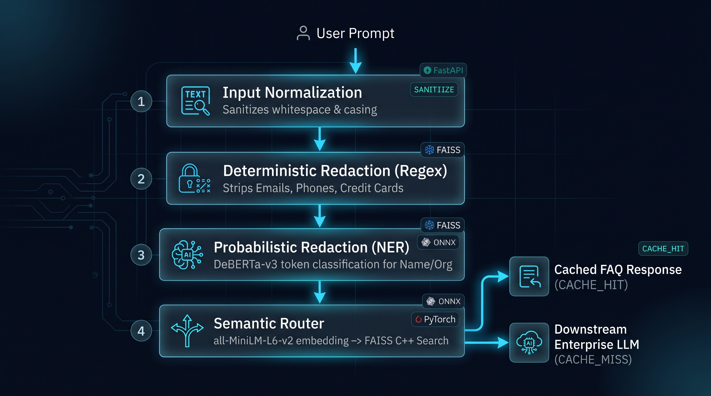
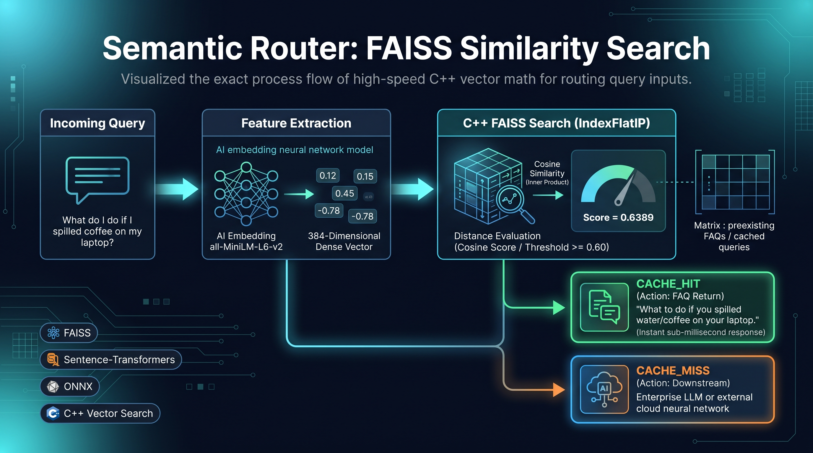
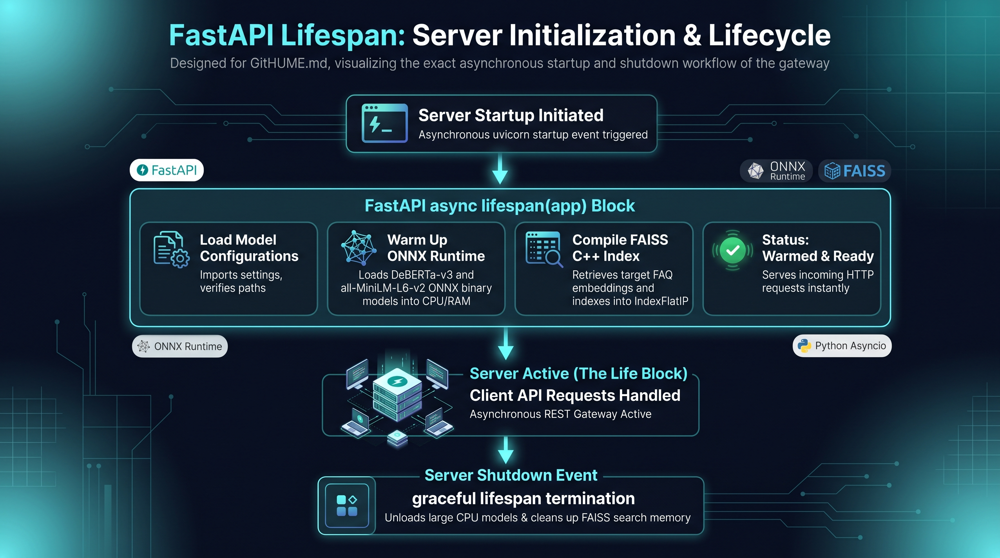

# AI Security Gateway & Semantic Router

An asynchronous, production-ready FastAPI microservice acting as a security and routing layer for Enterprise RAG systems. It intercepts user prompts, redacts PII using a hybrid Regex/NER approach, and uses Vector Search to route queries to cached FAQs or downstream LLMs.

## 🏗 Architecture

<p align="center">
  
</p>

This gateway executes a strict pipeline before any prompt touches a generative LLM:
1. **Input Normalization:** Sanitizes whitespace and structural casing.
2. **Deterministic Redaction (Regex):** Strips structured PII (Emails, Phone Numbers, Credit Cards).
3. **Probabilistic Redaction (NER):** Uses `DeBERTa-v3` token classification for unstructured PII (Names, Organizations). Implements interval-merging for subword fragmentation.
4. **Semantic Routing:** Embeds the sanitized prompt using `all-MiniLM-L6-v2` and searches a `FAISS` IndexFlatIP (Cosine Similarity) C++ struct to return cached answers in $O(N)$ time.

### How FAISS & Semantic Routing Works

Instead of expensive, slow calls to generative models for repetitive or common queries, the routing layer leverages high-speed C++ vector math:

<p align="center">
  
</p>

- **High-Dimensional Embedding:** The sanitized prompt is vectorized into 384 dimensions.
- **Index Search:** FAISS computes the cosine similarity against your index.
- **Dynamic Action:** If the score exceeds your set threshold (e.g., `0.60`), it fires a rapid cache-hit response. Otherwise, it safely proxies the redacted prompt downstream.

## 🛠 Tech Stack
* **Web Framework:** FastAPI, Uvicorn, Pydantic
* **AI & NLP:** ONNX Runtime, PyTorch, Transformers, Sentence-Transformers
* **Vector Search:** FAISS (Exact Search / Inner Product)
* **Package Management:** `uv`

## 🚀 Local Setup

### How FastAPI Handles Lifespan Setup

On startup, your API doesn't just launch a web server—it initializes the brain. Through the async `lifespan` handler, it safely downloads and loads the ONNX models into RAM, compiles the target FAISS dataset, and prepares your CPU-accelerated worker pool *before* allowing the gateway to receive its first network request:

<p align="center">
  
</p>

1. **Clone & Install Dependencies**
```bash
git clone [https://github.com/behradkamyab/LLM-secure-gateway.git](https://github.com/behradkamyab/LLM-secure-gateway.git)
cd LLM-secure-gateway
uv venv
source .venv/bin/activate  # On Windows: .venv\Scripts\activate
uv pip install -r requirements.txt
```

2. **Boot the Gateway**
```bash
uvicorn src.main:app --reload
```

## 🔌 API Usage

**Endpoint:** `POST /api/v1/gateway`

**Request:**
```json
{
  "prompts": [
    "My name is Behrad and I spilled coffee on my ThinkPad."
  ]
}
```

**Response:**
```json
{
  "results": [
    {
      "original_prompt": "My name is Behrad and I spilled coffee on my ThinkPad.",
      "redacted_prompt": "My name is [REDACTED] and I spilled coffee on my ThinkPad.",
      "routing": {
        "action": "CACHE_HIT",
        "score": 0.6389,
        "response": "What do I do if I spilled water on my laptop?"
      }
    }
  ]
}
```