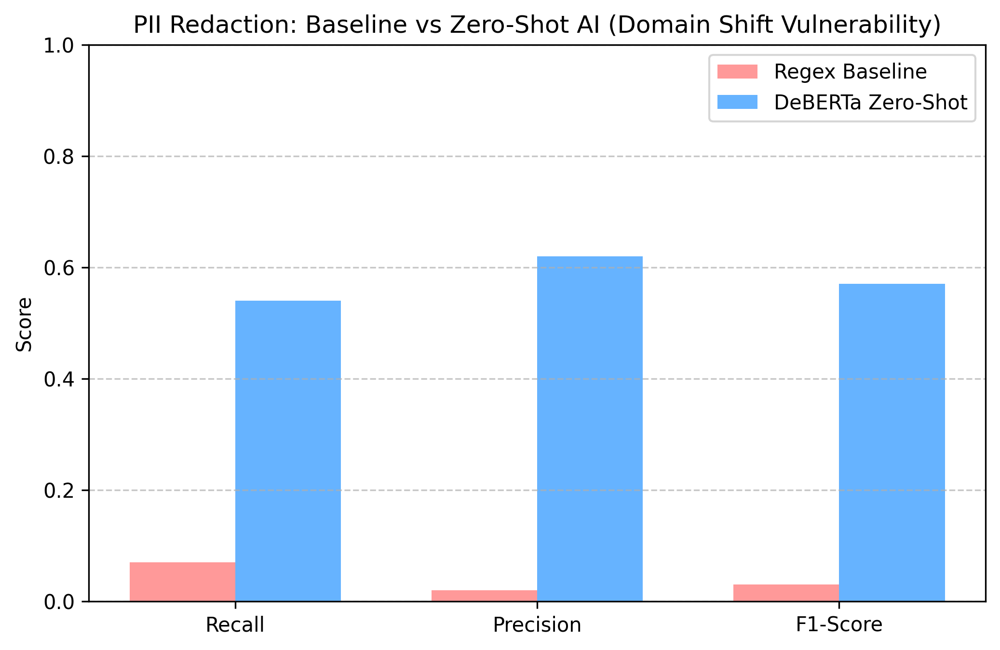

# Enterprise AI Security Gateway: Model Evaluation Report

## 1. Executive Summary
This report documents the baseline performance and zero-shot AI evaluation of the Enterprise AI Security Gateway. The system is designed as an asynchronous microservice using FastAPI, incorporating an ONNX-compiled `all-MiniLM-L6-v2` embedding model indexed in FAISS for semantic routing, and a `yonigo/deberta-v3-base-pii-en` token classifier for PII redaction. 

The primary Key Performance Indicators (KPIs) for this architecture are:
*   **Semantic Router:** Hit Rate @ 1 (The percentage of zero-shot semantic matches bypassing the LLM).
*   **PII Redaction:** Recall (Minimizing False Negatives to prevent critical data leaks), Precision (Minimizing False Positives to preserve user prompt context), and F1-Score.

This evaluation utilizes a synthetic dataset (`golden_dataset.json`) containing diverse, messy natural language queries, Italian enterprise names, and domain-specific corporate structures to accurately simulate real-world production traffic.

---

## 2. Routing Performance (The Success)
The evaluation compares a legacy keyword-matching baseline against the zero-shot FAISS semantic router.

*   **Legacy Keyword Baseline (0% Hit Rate):** Rigid substring `if/else` logic completely failed. It was unable to map natural language variations (e.g., mapping user queries about "vacation days" to the official "PTO" FAQ).
*   **Zero-Shot FAISS (80% Hit Rate):** The dense vector space successfully mapped 80% of unseen, misspelled queries to the exact official FAQ string using cosine similarity.

**Conclusion:** The 0% to 80% performance jump mathematically proves that semantic vector embeddings are required to handle the variance of human input in enterprise routing.

---

## 3. Redaction Vulnerability (The Domain Shift)
The evaluation compares a legacy Regex baseline against the zero-shot DeBERTa-v3 token classifier.

*   **Legacy Regex Baseline:** 7% Recall | 2% Precision | 3% F1-Score
    *   *Failure Mode:* Blindly hunting for capital letters and static patterns failed to catch 93% of PII and destroyed prompt integrity by flagging safe corporate nouns.
*   **Zero-Shot DeBERTa-v3:** 54% Recall | 62% Precision | 57% F1-Score
    *   *Failure Mode:* While vastly outperforming the baseline, a 54% Recall rate represents a critical security vulnerability, allowing nearly half of the sensitive entities to leak into the downstream LLM.

### Error Analysis & Domain Shift
The diagnostic logs revealed that the pre-trained `pii-en` model suffers from severe **Domain Shift**. It was trained on standard English naming conventions and lacks the vocabulary to process Italian enterprise data.

**Specific Logged Failures:**
*   `❌ MISSED: {'Antonietta Gotti'} | ⚠️ WRONG: {'Gotti'}`: The model identified the last name but failed to recognize "Antonietta" as a first name.
*   `❌ MISSED: {'Mauro Nicoletti'} | ⚠️ WRONG: {'Nicoletti'}`: Similar failure to map Italian first names in the embedding space.
*   `❌ MISSED: {'Patrick Moreno DDS'}`: The model's token sequence logic broke when encountering the "DDS" professional suffix at the end of the name, rather than the standard English "Dr." prefix.

---

## 4. Action Plan: Parameter-Efficient Fine-Tuning (PEFT)
The 54% Recall rate proves the open-source model is insufficient for this specific data distribution out-of-the-box. 

To secure the gateway, Phase 2 of the project will adapt the DeBERTa-v3 weights to the Italian enterprise domain. Because full-parameter fine-tuning is computationally expensive and risks catastrophic forgetting of the model's foundational English capabilities, we will implement **Low-Rank Adaptation (LoRA)** using the Hugging Face PEFT library. 

By injecting trainable rank decomposition matrices into the attention layers, the model will efficiently learn the custom corporate structures from a BIO-tagged version of our synthetic dataset while freezing the foundational weights. We will utilize **MLflow** to track the hyperparameter configurations and document the Recall/Precision improvements across training epochs.